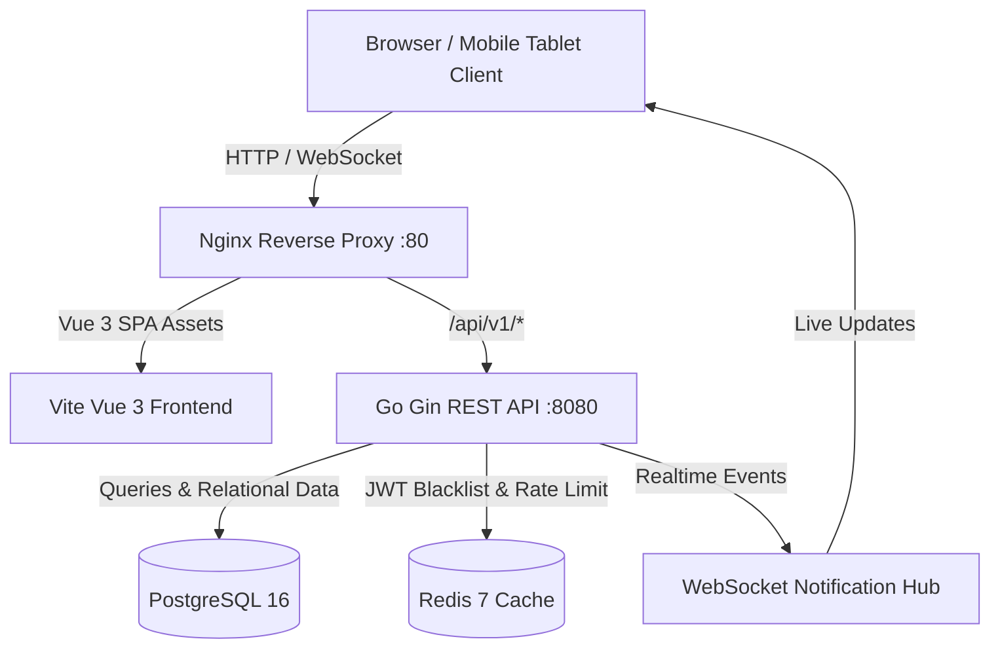
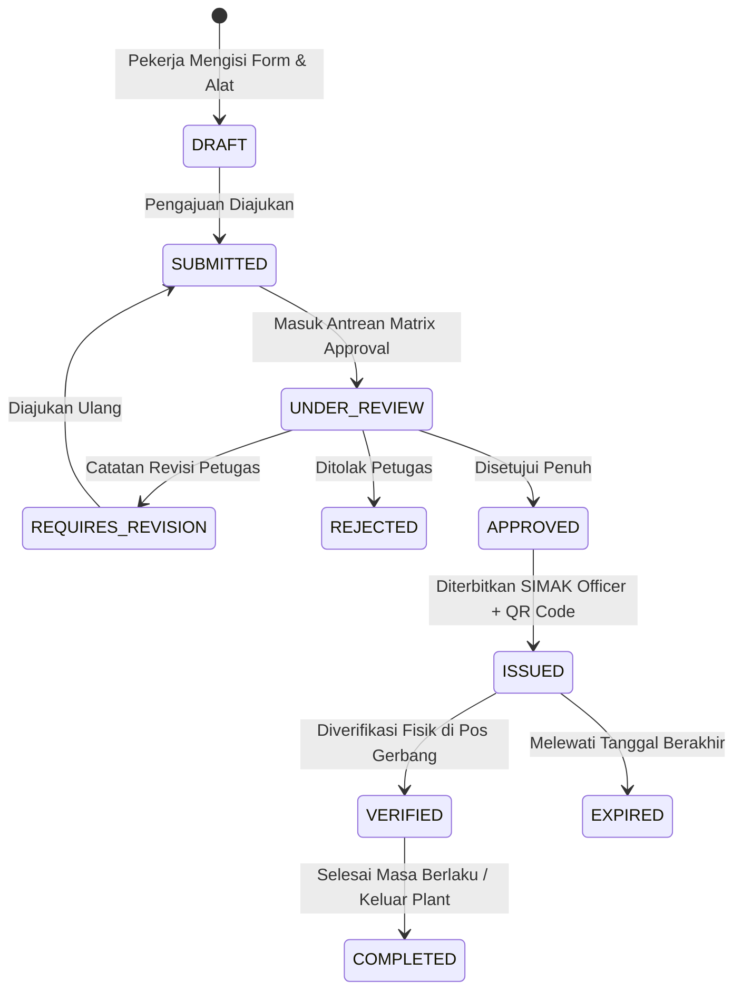

# Sistem Informasi Manajemen Barang Bawaan Pekerja (SIMAK)
### PT Industri Kereta Api (Persero) — Workshop & Plant Security Management System

[](https://golang.org)
[](https://vuejs.org)
[](https://postgresql.org)
[](https://redis.io)
[](#)

---

## 📋 Ikhtisar Sistem (System Overview)

**SIMAK (Surat Izin Masuk Alat & Kerja)** adalah platform manajemen dan tata kelola keamanan aset digital terpadu milik **PT INKA (Persero)**. Sistem ini menggantikan formulir kertas manual dalam pengawasan lalu lintas peralatan kerja personil internal, subkontraktor, dan vendor eksternal yang keluar-masuk area industri kereta api (pabrik Madiun & Banyuwangi).

### 🚀 Pilar Utama Sistem
1. **Digital Permitting:** Pengajuan izin alat kerja terperinci (No. Seri, Merek, Kategori, Model, Jumlah, Foto Bukti).
2. **Configurable Multi-Level Approval:** Alur persetujuan berjenjang fleksibel berbasis divisi/perusahaan tanpa *hardcode*.
3. **Secure QR Issuance:** Penerbitan dokumen resmi berkop INKA dengan QR Code terenkripsi anti-pemalsuan.
4. **Mobile Gate Inspection:** Checklist verifikasi fisik di pos gerbang keamanan dengan deteksi instan *Match / Mismatch*.
5. **Discrepancy Audit Management:** Otomasi pencatatan kasus ketidaksesuaian barang, investigasi pengawas, dan putusan resolusi.
6. **Real-time Notifications:** Streaming WebSocket instan & cron pengingat kedaluwarsa masa berlaku izin (H-3 & Expired).
7. **Role-Aware Dashboard & Analytics:** Dasbor eksekutif dengan grafik tren mingguan (sorotan hari puncak Merah INKA `#D32F2F`), rekap laporan multi-kategori, dan ekspor CSV UTF-8 BOM.
8. **Immutable Audit Trail:** Rekaman jejak audit *tamper-proof* untuk seluruh aksi sensitif dan pengujian keamanan OWASP.

---

## 🏛️ Arsitektur & Teknologi (Tech Stack)



- **Backend:** Golang 1.23, Gin Web Framework, GORM ORM, Zerolog, Gorilla WebSocket, Swaggo.
- **Frontend:** Vue 3 (Composition API + `<script setup>`), TypeScript, Vite, Tailwind CSS, Pinia, Vue Router.
- **Basis Data & Cache:** PostgreSQL 16 (UUID v4, JSONB, Indeks b-tree), Redis 7 (Token Blacklisting & Sliding-window Rate Limiting).
- **Keamanan:** JWT HS256, RBAC 6 Peran, Granular Permissions, OWASP Security Headers (nosniff, DENY, CSP).

---

## 👥 Pengguna & Akun Uji Coba (Demo Accounts)

Sistem telah dilengkapi dengan data awalan (*seeded data*) untuk 6 peran pengguna:

| Peran (Role) | Email | Kata Sandi | Deskripsi & Wewenang |
|---|---|---|---|
| **Administrator** | `admin@inka.co.id` | `Admin123!` | Kontrol penuh sistem, master data, konfigurasi matrix, dan audit trail log. |
| **Applicant (Pekerja)** | `pekerja@inka.co.id` | `Pekerja123!` | Mendata barang rutin, membuat draft, dan mengajukan SIMAK baru. |
| **Approver** | `approver@inka.co.id` | `Approver123!` | Menyetujui (*Approve*), menolak (*Reject*), atau meminta perbaikan (*Revision*). |
| **SIMAK Officer** | `officer@inka.co.id` | `Officer123!` | Menerbitkan dokumen resmi, menghasilkan token QR keamanan, dan mencetak surat. |
| **Gate Officer (Satpam)** | `gate@inka.co.id` | `Gate123!` | Memindai QR pos gerbang, verifikasi fisik checklist barang, dan mencatat pergerakan. |
| **Supervisor** | `supervisor@inka.co.id` | `Supervisor123!` | Menginvestigasi selisih barang (*Discrepancy*), memberi putusan, dan akses audit. |

---

## 🔄 Alur Siklus Hidup SIMAK (Workflow Lifecycle)



---

## 🚀 Panduan Menjalankan Sistem

### Opsi A: Deployment Produksi (Docker Compose) — *Rekomendasi*
Pastikan Docker dan Docker Compose telah terpasang di server Anda:

```bash
# 1. Clone repository
git clone https://github.com/mfarhannugroho/simak-management.git
cd simak-management

# 2. Jalankan seluruh layanan dengan konfigurasi produksi
docker compose -f docker-compose.prod.yml up -d --build

# 3. Periksa status kontainer
docker compose -f docker-compose.prod.yml ps
```
Aplikasi langsung dapat diakses pada browser di:
- **Frontend & Aplikasi:** `http://localhost/` (Port 80)
- **API Health Check:** `http://localhost/api/v1/health`
- **Swagger Documentation:** `http://localhost/swagger/index.html`

---

### Opsi B: Menjalankan Secara Lokal untuk Pengembangan

#### 1. Prasyarat:
- Go 1.22+
- Node.js 20+ & npm
- PostgreSQL 16 & Redis 7 aktif secara lokal

#### 2. Menjalankan Backend:
```bash
cd backend
# Salin konfigurasi environment
cp .env.example .env

# Jalankan server
go run cmd/server/main.go
# Server aktif pada port 8080
```

#### 3. Menjalankan Frontend:
```bash
cd frontend
# Instal dependensi
npm install

# Jalankan Vite dev server
npm run dev
# Frontend aktif pada http://localhost:5173
```

---

## 🧪 Pengujian Otomatis (Automated Testing)

Jalankan rangkaian unit testing backend untuk memverifikasi logika bisnis dan alur status:

```bash
cd backend
go test -v -race ./internal/simak ./internal/inspection
```

Jalankan pengecekan tipe data dan bundle frontend:
```bash
cd frontend
npm run build
```

---

## 💾 Strategi Pencadangan Database (Backup & Recovery)

Tersedia skrip otomatis untuk pencadangan terkompresi dengan rotasi penyimpanan:

- **Linux / Production Server:**
  ```bash
  chmod +x scripts/backup_db.sh
  ./scripts/backup_db.sh
  ```
- **Windows Server:**
  ```powershell
  powershell -ExecutionPolicy Bypass -File scripts/backup_db.ps1
  ```

---

## 📚 Dokumentasi API Terintegrasi
Dokumentasi interaktif OpenAPI / Swagger dapat dibuka langsung melalui browser di:
`http://localhost:8080/swagger/index.html`

---

### Hak Cipta & Lisensi
© 2026 PT Industri Kereta Api (Persero). Seluruh hak cipta dilindungi undang-undang.
Dibuat untuk standardisasi keselamatan kerja dan pengawasan aset pabrik kereta api nasional.
